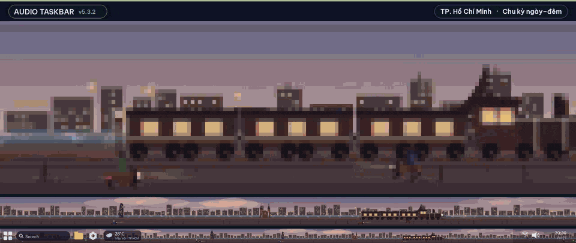
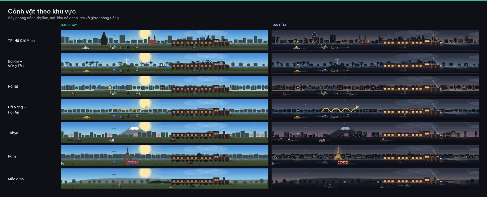
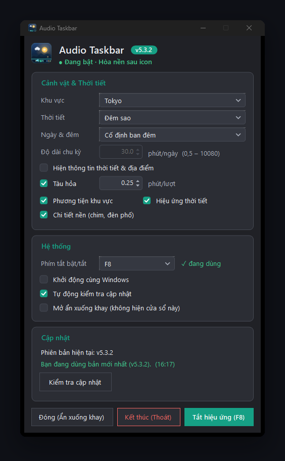

# Audio Taskbar

Diorama thời tiết sống, vẽ ngay trên nền thanh taskbar Windows 11.
Hiệu ứng nằm **phía sau** icon — Start, Search, ứng dụng và khay hệ thống vẫn sắc nét, bấm bình thường.

> Bản MP4 chất lượng cao hơn: [`docs/images/demo.mp4`](docs/images/demo.mp4) (1920×810, 30 fps, ~30 giây).

## Hình ảnh

**Thanh taskbar Windows 11** — icon hòa nền trên diorama, ví dụ Tokyo tuyết rơi.

**Cảnh vật theo khu vực** — bảy phong cách skyline, ban ngày và ban đêm.

**Tuyết rơi** — Tokyo, Paris và cảnh mặc định lúc ban ngày, bình minh và ban đêm.

**Bảng điều khiển v5.3.2** — giao diện tối, nút Bật/Tắt (F8) ở hàng dưới cùng.

## Cài đặt nhanh

Windows 11 64-bit. Không cần quyền Administrator, không cần cài .NET.

1. Tải từ [Release mới nhất](https://github.com/Hieunguyen00000/AudioTaskbar/releases/latest):
   - **`AudioTaskbar.exe`** — bản portable, double-click là chạy; hoặc
   - **`AudioTaskbar-Setup-5.3.3.exe`** — bộ cài theo user (shortcut, tùy chọn khởi động cùng Windows).
2. Tìm icon **Audio Taskbar** ở khay hệ thống (gần đồng hồ, đôi khi nằm trong mũi tên overflow).
3. Nhấn **F8** để bật/tắt hiệu ứng. Nhấp đúp icon khay để mở bảng điều khiển.

> **Smart App Control / SmartScreen.** Bản phát hành hiện **chưa ký số**, nên Windows có thể cảnh báo hoặc chặn file tải từ internet (đặc biệt khi Smart App Control đang bật). SmartScreen: *More info* → *Run anyway*. Chi tiết và lộ trình ký số miễn phí: [Code signing policy](docs/CODE_SIGNING.md). Khi `TaskbarTap.dll` bị chặn, app tự chuyển sang chế độ khoét icon an toàn — không lách SAC.

## Có gì mới trong v5.3.3

- **Màn Start không làm cảnh vật nhảy.** Mở hoặc đóng menu Start (phím Windows) giữ nguyên vùng trời, thời tiết, thời điểm trong ngày và vị trí phương tiện. Chỉ khi hình dạng taskbar thật sự đổi thì layout mới được đo lại, và lúc đó cũng không random lại cảnh.
- **Tùy chỉnh Personalization → Taskbar.** Thanh dọc (trái/phải) vẽ panorama dọc theo cạnh dài, mặt đất hướng vào desktop, không bị kéo méo. Ẩn tự động (kể cả khi Windows để một khe ~2px) ẩn overlay cùng thanh và không chặn điểm hiện lại. Đổi kích thước / căn icon / nhiều màn hình được tính theo chiều dày và trục dài thật, không cứng 48px hay chỉ thanh dưới. Một lần Explorer khởi động lại khi đổi setting không tắt TAP cả phiên (cần hai lần thoát trong 90 giây mới chuyển sang chế độ khoét icon an toàn). Overlay không reset cảnh khi chỉ đổi vị trí hay kích thước thanh.

## Sử dụng & tùy chỉnh cơ bản

Mọi thay đổi trong bảng điều khiển và menu khay được áp dụng ngay và lưu vào `config.json`.

| Việc | Cách |
|------|------|
| Bật / tắt hiệu ứng | **F8**, nút *Tắt/Bật hiệu ứng (F8)* trên bảng điều khiển, hoặc menu khay |
| Mở bảng điều khiển | Nhấp đúp icon khay, chọn *Mở bảng điều khiển*, hoặc chạy lại `AudioTaskbar.exe` |
| Ẩn cửa sổ, app vẫn chạy | **Đóng (Ẩn xuống khay)** hoặc nút ✕ |
| Thoát hẳn, trả taskbar gốc | **Kết thúc (Thoát)** trên bảng điều khiển hoặc menu khay |
| Khu vực | *Cảnh vật & Thời tiết* — Tự động theo máy, TP. Hồ Chí Minh, Bà Rịa – Vũng Tàu, Hà Nội, Đà Nẵng – Hội An, Tokyo, Paris, Mặc định |
| Thời tiết | *Thực tế* (Open-Meteo) hoặc xem trước: Nắng đẹp, Mây trôi, Mưa rào, Giông bão, Tuyết rơi, **Đêm sao** |
| Ngày & đêm | Theo chu kỳ tùy chỉnh, theo giờ thật, cố định ban ngày, cố định ban đêm |
| Độ dài chu kỳ | `0,5`–`10080` phút/ngày (30 giây đến 7 ngày). Chỉ bật khi đang ở chế độ chu kỳ |
| Tàu hỏa | Bật/tắt và số **phút/lượt** |
| Phương tiện, chi tiết nền, hiệu ứng thời tiết, thẻ thời tiết | Các ô kiểm trên bảng điều khiển hoặc menu khay |
| Khởi động cùng Windows | Ô *Hệ thống* (mặc định tắt) |
| Tự kiểm tra cập nhật | Bật mặc định; nút *Kiểm tra cập nhật* trên thẻ *Cập nhật* |

Chọn thời tiết **Đêm sao** sẽ tự chuyển *Ngày & đêm* sang **Cố định ban đêm**. Các thời tiết khác giữ nguyên chế độ ngày–đêm bạn đang dùng.

## Cấu hình

Cấu hình, log và cache nằm ở `%LOCALAPPDATA%\AudioTaskbar\` (`config.json`, `app.log`). Không lưu trong thư mục cài. Mẫu: [`config.example.json`](config.example.json).

Một số khóa thường dùng trong <code>config.json</code>

| Khóa | Mặc định | Ý nghĩa |
|------|----------|---------|
| `timeMode` | `"cycle"` | `cycle` (chu kỳ tùy chỉnh), `real` (giờ thật), `day`, `night` |
| `dayCycleMinutes` | `30` | Độ dài một ngày ảo khi `timeMode` là `cycle` (`0.5`–`10080`) |
| `regionMode` | `"auto"` | `"auto"` hoặc chọn khu vực trong bảng điều khiển |
| `weatherPreview` | `"live"` | `live`, `sunny`, `cloudy`, `rain`, `storm`, `snow`, `night` (Đêm sao) |
| `showWeatherHud` | `true` | Hiện thẻ nhiệt độ & địa điểm trên taskbar |
| `trainCrossingMinutes` | `1` | Số phút cho một lượt tàu |
| `hotkey` | `"F8"` | Phím tắt toàn cục (ví dụ `Ctrl+Alt+F8`) |
| `autoUpdateEnabled` | `true` | Tự kiểm tra GitHub Release |
| `startMinimized` | `false` | Chạy ẩn xuống khay (`--minimized` khi khởi động cùng Windows) |

Tham chiếu đầy đủ: [docs/configuration.md](docs/configuration.md).

## Code signing policy

Free code signing provided by SignPath.io, certificate by SignPath Foundation.

Audio Taskbar is applying to the [SignPath Foundation](https://signpath.org/) open-source program so that `AudioTaskbar.exe`, `TaskbarTap.dll` (signed *before* it is embedded and later extracted to `%LOCALAPPDATA%\AudioTaskbar\`) and `AudioTaskbar-Setup-*.exe` can be Authenticode-signed. **Status: pending approval.** Until a signed GitHub Release is published, Windows 11 Smart App Control / SmartScreen may still report an unknown publisher.

- Policy, team roles (Author / Reviewer / Approver: [Hieu Nguyen Van](https://github.com/Hieunguyen00000)) and the two-phase CI signing flow: [docs/CODE_SIGNING.md](docs/CODE_SIGNING.md).
- What the app sends over the network and how to turn each request off: [PRIVACY.md](PRIVACY.md).
- `TaskbarTap.dll` is loaded through the documented Windows `InitializeXamlDiagnosticsEx` API (no `CreateRemoteThread`, no attempt to bypass Smart App Control). If Code Integrity blocks the DLL, the app falls back to UIA icon-safe mode.

## Tài liệu

- [Kiến trúc hệ thống](docs/architecture.md)
- [Tham chiếu cấu hình](docs/configuration.md)
- [Phát triển & build](docs/development.md)
- [Xử lý sự cố](docs/troubleshooting.md)
- [Code signing policy](docs/CODE_SIGNING.md)
- [Privacy policy](PRIVACY.md)
- [Security policy](SECURITY.md)
- [Code of conduct](CODE_OF_CONDUCT.md)

## License

MIT. Xem [LICENSE](LICENSE) và [NOTICE.md](NOTICE.md).
