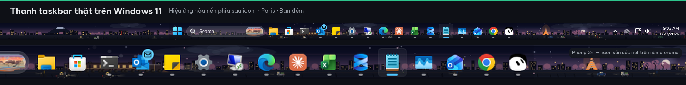
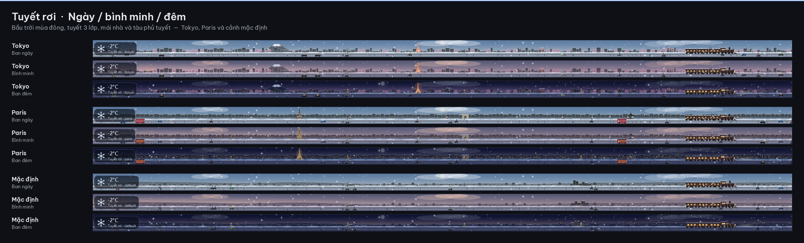

# Audio Taskbar

Diorama thời tiết sống, vẽ ngay trên nền thanh taskbar Windows 11.
Hiệu ứng nằm **phía sau** icon — Start, Search, ứng dụng và khay hệ thống vẫn sắc nét, bấm bình thường.

## Hình ảnh

**Thanh taskbar Windows 11** — icon hòa nền trên diorama, ví dụ Tokyo tuyết rơi.

**Cảnh vật theo khu vực** — bảy phong cách skyline, ban ngày và ban đêm.

**Tuyết rơi** — Tokyo, Paris và cảnh mặc định lúc ban ngày, bình minh và ban đêm.

**Bảng điều khiển v5.3.2** — giao diện tối, nút Bật/Tắt (F8) ở hàng dưới cùng.

## Cài đặt nhanh

Windows 11 64-bit. Không cần quyền Administrator, không cần cài .NET.

1. Tải từ [Release mới nhất](https://github.com/Hieunguyen00000/AudioTaskbar/releases/latest):
   - **`AudioTaskbar.exe`** — bản portable, double-click là chạy; hoặc
   - **`AudioTaskbar-Setup-5.4.2.exe`** — bộ cài theo user (shortcut, tùy chọn khởi động cùng Windows).
2. Tìm icon **Audio Taskbar** ở khay hệ thống (gần đồng hồ, đôi khi nằm trong mũi tên overflow).
3. Nhấn **F8** để bật/tắt hiệu ứng. Nhấp đúp icon khay để mở bảng điều khiển.

> **Smart App Control / SmartScreen.** Bản phát hành hiện **chưa ký số**, nên Windows có thể cảnh báo hoặc chặn file tải từ internet (đặc biệt khi Smart App Control đang bật). SmartScreen: *More info* → *Run anyway*. Chi tiết và lộ trình ký số miễn phí: [Code signing policy](docs/CODE_SIGNING.md). Khi `TaskbarTap.dll` bị chặn, app tự chuyển sang chế độ khoét icon an toàn — không lách SAC.

## Có gì mới trong v5.4.2

- **Bảng điều khiển hiển thị đúng ở mọi mức scale.** Cửa sổ tự co giãn theo DPI của từng màn hình (PerMonitorV2, 100–200 %): cột nhãn, ô chọn và thẻ tự rộng theo nội dung, không còn chữ bị cắt hay xuống dòng. Màn hình thấp thì chỉ có thanh cuộn dọc, nằm cạnh nội dung (không che cột bên phải).
- **Mùa: thêm *Tự đổi mùa* và *Thực tế* ngay trong danh sách.** *Thực tế* lấy mùa thật theo ngày và vị trí, có tính bán cầu; vùng nhiệt đới như TP.HCM dùng ánh xạ riêng (xuân tháng 1–2, hè 3–7, thu 8–12, không có đông). Ô *Xuân → hè → thu → đông* riêng đã bỏ; ô số phút chỉ hiện khi chọn *Tự đổi mùa*.
- **Thời tiết: thêm *Ngẫu nhiên*** thay cho cài đặt *Tự đổi thời tiết*. Dòng *Đổi sau mỗi … phút* chỉ hiện khi chọn *Ngẫu nhiên*. Cấu hình cũ đang bật tự đổi chuyển sang *Ngẫu nhiên*.
- **Máy bay không còn đường băng.** Máy bay xuất hiện đã ở trên không, thấp ở mép trái, leo dần; bay ngang qua giữa; rồi hạ dần và biến mất ở mép phải. Không có gì trên mặt đất.
- **Phối âm chuẩn theo cảnh** (*Tự phối theo cảnh*, bật mặc định): mưa và sấm mạnh khi giông, dế về đêm, sóng ở vùng biển, xe cộ ở đô thị. Hiệu ứng nào bạn kéo tay thì được giữ nguyên; nút *Phối lại theo cảnh* đưa tất cả về mức chuẩn. **Âm lượng tổng chỉ do bạn chỉnh** (mặc định 0). Chi tiết: [docs/configuration.md](docs/configuration.md#phối-âm-chuẩn-theo-cảnh-v542).
- **Tàu hỏa chạy lâu hơn, dừng ga ngắn hơn:** với vòng 2 phút, chạy 100,8 s (trước 91,2 s), dừng ga 14,4 s (trước 24 s).
- **Bỏ khu vực Rome, Cairo – Giza và Santorini.** Cấu hình đang chọn các khu vực này tự chuyển về *Tự động*.
- Dòng trạng thái đầu bảng điều khiển gọn hơn: *Đang bật · F8 bật/tắt* (bỏ *Hòa nền sau icon*).

## Có gì mới trong v5.4.1

- **Máy bay chỉ cất cánh.** Máy bay lăn bánh từ mép trái taskbar, cất cánh, leo lên, bay ngang ở độ cao giữa thanh (*cruise*), rồi hạ dần và rời khỏi tầm nhìn ở thấp gần mép phải (không hạ cánh, không có nhà ga, tháp kiểm soát, cầu thang hay hành khách). Một đường băng ngắn ở bên trái; xe cộ không chạy vào đó. Số phút/vòng là khoảng cách giữa các lần cất cánh. Tàu hỏa giữ nguyên.
- **Âm thanh nền là bản thu thật (CC0, mặc định im lặng).** Mưa rừng nặng hạt ngoài trời, sấm sét, xe cộ, còi xe, tiếng còi tàu, chim, côn trùng, ếch/chó/gà và sóng nước là các bản thu CC0 (Freesound), nhúng sẵn trong exe (khoảng 4 MB), chỉ giải mã khi bạn kéo thanh âm lượng lên. **Sấm khớp với tia chớp** trên diorama: mỗi tia chớp kéo theo một tiếng sấm, trễ hơn và nhỏ/trầm hơn khi sấm ở xa. Gió, máy bay và tiếng ray tàu vẫn được tổng hợp trong app. Nguồn và giấy phép từng bản thu: [`NOTICE.md`](NOTICE.md). Âm lượng tổng và từng hiệu ứng **đặt 0** kể cả khi nâng cấp từ cấu hình cũ; các vòng lặp nối liền mạch, vào/ra mềm; tạm dừng khi tắt hiệu ứng và dừng hẳn khi thoát.

## Có gì mới trong v5.4.0

- **Âm thanh nền (mặc định im lặng).** Mưa, sấm, gió, xe cộ, còi xe, tàu hỏa vào ga (xa/gần, chuyển kênh trái–phải), máy bay cất/hạ cánh, chim, côn trùng ban đêm, ếch/chó/gà, sóng nước — trộn theo khu vực, thời tiết, mùa và giờ trong ngày. Có âm lượng tổng và từng hiệu ứng, **tất cả đặt 0** kể cả khi nâng cấp từ cấu hình cũ. Âm thanh được tổng hợp ngay trong app (không file âm thanh, không bản quyền bên thứ ba), nối vòng liền mạch, vào/ra mềm; tạm dừng khi tắt hiệu ứng và dừng hẳn khi thoát.
- **Bốn mùa.** Xuân, hè, thu, đông với bảng màu trời/đất riêng (cánh hoa, lá rơi, tuyết phủ). Chọn thời tiết *Tuyết rơi* sẽ tự sang mùa đông. Có thể **tự đổi mùa** theo chu kỳ phút tùy chỉnh.
- **Thời tiết tự đổi.** Theo chu kỳ cố định hoặc ngẫu nhiên trong khoảng bạn đặt, luôn hợp mùa (tuyết chỉ vào mùa đông).
- **5 địa danh nổi tiếng mới:** Sydney (Nhà hát Opera, cầu Cảng), New York (Tượng Nữ thần Tự do, Empire State, cầu Brooklyn), Rome (Đấu trường La Mã, St. Peter), Giza (Kim tự tháp, Sphinx), Santorini (nhà vòm xanh, cối xay gió). Mỗi nơi có phương tiện và nhịp phố riêng.
- **Bảng điều khiển gọn hơn.** Mặc định gồm bốn khối đồng dạng: *Thông tin cảnh vật & vị trí*, *Thời tiết*, *Mùa*, *Khung cảnh* (ngày–đêm, tàu hỏa, máy bay, phương tiện, chi tiết nền, vùng đệm). Tàu hỏa và máy bay mỗi thứ chỉ một dòng: tên, ô *Bật* và số phút của một vòng. Âm thanh và mục *Cài đặt* (hệ thống, cập nhật, phím tắt) nằm trong phần có thể thu gọn. Nút **Lưu cấu hình** nằm ở chân bảng điều khiển (góc phải, cạnh *Đóng* và *Kết thúc*), kèm dòng nhỏ *Đã lưu / Chưa lưu*: chỉnh sửa xem trước ngay, chỉ ghi `config.json` khi bấm Lưu; đóng khi còn thay đổi chưa lưu sẽ hỏi.
- **Một nút cập nhật.** *Kiểm tra & cập nhật* (bảng điều khiển và menu khay) thay cho hai nút cũ. App tự kiểm tra và cài khi mở theo các tùy chọn cập nhật tự động hiện có (mặc định bật).
- **Tùy chọn vùng đệm xám quanh icon** (hàng *Vùng đệm xám* trong khối *Khung cảnh*): tắt để cảnh vật sát icon.
- **Gọn menu khay.** Bỏ mục *Hiện thông tin thời tiết địa điểm* (thông tin nằm trong bảng điều khiển; thẻ trên taskbar đã bỏ) và mục *Tắt hiệu ứng (F8)* (phím **F8** vẫn hoạt động; nút Bật/Tắt ở chân bảng điều khiển được thay bằng *Lưu cấu hình*).

## Có gì mới trong v5.3.3

- **Màn Start không làm cảnh vật nhảy.** Mở hoặc đóng menu Start (phím Windows) giữ nguyên vùng trời, thời tiết, thời điểm trong ngày và vị trí phương tiện. Chỉ khi hình dạng taskbar thật sự đổi thì layout mới được đo lại, và lúc đó cũng không random lại cảnh.
- **Tùy chỉnh Personalization → Taskbar.** Thanh dọc (trái/phải) vẽ panorama dọc theo cạnh dài, mặt đất hướng vào desktop, không bị kéo méo. Ẩn tự động (kể cả khi Windows để một khe ~2px) ẩn overlay cùng thanh và không chặn điểm hiện lại. Đổi kích thước / căn icon / nhiều màn hình được tính theo chiều dày và trục dài thật, không cứng 48px hay chỉ thanh dưới. Một lần Explorer khởi động lại khi đổi setting không tắt TAP cả phiên (cần hai lần thoát trong 90 giây mới chuyển sang chế độ khoét icon an toàn). Overlay không reset cảnh khi chỉ đổi vị trí hay kích thước thanh.

## Sử dụng & tùy chỉnh cơ bản

Thay đổi trong bảng điều khiển được xem trước ngay; bấm **Lưu cấu hình** để ghi vào `config.json` (menu khay lưu ngay). Đóng khi chưa lưu sẽ hỏi.

| Việc | Cách |
|------|------|
| Bật / tắt hiệu ứng | Phím tắt **F8** (hiện trên dòng trạng thái đầu bảng điều khiển) |
| Mở bảng điều khiển | Nhấp đúp icon khay, chọn *Mở bảng điều khiển*, hoặc chạy lại `AudioTaskbar.exe` |
| Ẩn cửa sổ, app vẫn chạy | **Đóng (Ẩn xuống khay)** hoặc nút ✕ |
| Thoát hẳn, trả taskbar gốc | **Kết thúc (Thoát)** trên bảng điều khiển hoặc menu khay |
| Khu vực | *Cảnh vật & Thời tiết* — Tự động theo máy, TP. Hồ Chí Minh, Bà Rịa – Vũng Tàu, Hà Nội, Đà Nẵng – Hội An, Tokyo, Paris, **Sydney, New York** (v5.4), Mặc định |
| Thời tiết | *Thực tế* (Open-Meteo), **Ngẫu nhiên** (đổi sau khoảng phút ngẫu nhiên, hợp mùa) hoặc xem trước: Nắng đẹp, Mây trôi, Mưa rào, Giông bão, Tuyết rơi, **Đêm sao** |
| Ngày & đêm | Theo chu kỳ tùy chỉnh, theo giờ thật, cố định ban ngày, cố định ban đêm |
| Độ dài chu kỳ | `0,5`–`10080` phút/ngày (30 giây đến 7 ngày). Chỉ bật khi đang ở chế độ chu kỳ |
| Tàu hỏa | Bật/tắt và số **phút/vòng**: tàu vào ga chậm dần, dừng ngắn ở sân ga nhỏ, khách xuống rồi khách lên, đóng cửa, rời ga và tăng tốc |
| Máy bay | Bật/tắt và số **phút/vòng** (mặc định 3): xuất hiện thấp trên không ở mép trái và leo dần, bay ngang qua giữa thanh, hạ dần và biến mất ở mép phải. Không có đường băng |
| Mùa | *Thực tế* (theo ngày và vị trí), *Tự đổi mùa* (kèm số phút mỗi mùa), hoặc *Mùa xuân/hè/thu/đông* |
| Phương tiện, chi tiết nền, hiệu ứng thời tiết, vùng đệm icon | Các ô kiểm trên bảng điều khiển |
| Âm thanh nền | Mục *Âm thanh nền* (thu gọn): âm lượng tổng (mặc định 0, chỉ bạn chỉnh) + từng hiệu ứng, tự phối theo cảnh hoặc kéo tay. Bản thu CC0 (mưa rừng, sấm khớp tia chớp, …); nguồn trong [`NOTICE.md`](NOTICE.md) |
| Lưu thay đổi | Nút **Lưu cấu hình** |
| Khởi động cùng Windows | Ô *Hệ thống* (mặc định tắt) |
| Cập nhật | Tự kiểm tra và cài khi mở app (bật mặc định); nút *Kiểm tra & cập nhật* trong *Cài đặt* hoặc menu khay |

Chọn thời tiết **Đêm sao** sẽ tự chuyển *Ngày & đêm* sang **Cố định ban đêm**. Các thời tiết khác giữ nguyên chế độ ngày–đêm bạn đang dùng.

## Cấu hình

Cấu hình, log và cache nằm ở `%LOCALAPPDATA%\AudioTaskbar\` (`config.json`, `app.log`). Không lưu trong thư mục cài. Mẫu: [`config.example.json`](config.example.json).

Một số khóa thường dùng trong <code>config.json</code>

| Khóa | Mặc định | Ý nghĩa |
|------|----------|---------|
| `timeMode` | `"cycle"` | `cycle` (chu kỳ tùy chỉnh), `real` (giờ thật), `day`, `night` |
| `dayCycleMinutes` | `30` | Độ dài một ngày ảo khi `timeMode` là `cycle` (`0.5`–`10080`) |
| `regionMode` | `"auto"` | `"auto"` hoặc chọn khu vực trong bảng điều khiển |
| `weatherPreview` | `"live"` | `live`, `random` (Ngẫu nhiên), `sunny`, `cloudy`, `rain`, `storm`, `snow`, `night` (Đêm sao) |
| `season` | `"summer"` | `real` (Thực tế), `cycle` (Tự đổi mùa), `spring`, `summer`, `autumn`, `winter` |
| `seasonCycleMinutes` | `30` | Số phút mỗi mùa khi `season` là `cycle` |
| `weatherCycleRandom{Min,Max}Minutes` | `5` / `20` | Khoảng chờ của thời tiết *Ngẫu nhiên* |
| `showIconPadding` | `true` | Vùng đệm xám quanh icon |
| `soundMasterVolume`, `soundVolumes` | tất cả `0` | Âm thanh nền 0–100 (tổng chỉ do bạn chỉnh) |
| `soundAutoMix` / `soundManual` | `true` / `[]` | Tự phối từng hiệu ứng theo cảnh; danh sách hiệu ứng đã kéo tay |
| `trainCrossingMinutes` | `2` | Số phút cho một vòng của tàu: vào ga, dừng đón/trả khách, rời ga |
| `showAirplane` | `true` | Máy bay: xuất hiện thấp bên trái và leo, bay ngang, hạ dần và biến mất bên phải |
| `airplaneCycleMinutes` | `3` | Số phút cho một vòng của máy bay (0.5–240) |
| `hotkey` | `"F8"` | Phím tắt toàn cục (ví dụ `Ctrl+Alt+F8`) |
| `autoUpdateEnabled` | `true` | Tự kiểm tra GitHub Release |
| `startMinimized` | `false` | Chạy ẩn xuống khay (`--minimized` khi khởi động cùng Windows) |

Tham chiếu đầy đủ: [docs/configuration.md](docs/configuration.md).

## Code signing policy

Free code signing provided by SignPath.io, certificate by SignPath Foundation.

Audio Taskbar is applying to the [SignPath Foundation](https://signpath.org/) open-source program so that `AudioTaskbar.exe`, `TaskbarTap.dll` (signed *before* it is embedded and later extracted to `%LOCALAPPDATA%\AudioTaskbar\`) and `AudioTaskbar-Setup-*.exe` can be Authenticode-signed. **Status: pending approval.** Until a signed GitHub Release is published, Windows 11 Smart App Control / SmartScreen may still report an unknown publisher.

- Policy, team roles (Author / Reviewer / Approver: [Hieu Nguyen Van](https://github.com/Hieunguyen00000)) and the two-phase CI signing flow: [docs/CODE_SIGNING.md](docs/CODE_SIGNING.md).
- What the app sends over the network and how to turn each request off: [PRIVACY.md](PRIVACY.md).
- `TaskbarTap.dll` is loaded through the documented Windows `InitializeXamlDiagnosticsEx` API (no `CreateRemoteThread`, no attempt to bypass Smart App Control). If Code Integrity blocks the DLL, the app falls back to UIA icon-safe mode.

## Tài liệu

- [Kiến trúc hệ thống](docs/architecture.md)
- [Tham chiếu cấu hình](docs/configuration.md)
- [Phát triển & build](docs/development.md)
- [Xử lý sự cố](docs/troubleshooting.md)
- [Code signing policy](docs/CODE_SIGNING.md)
- [Privacy policy](PRIVACY.md)
- [Security policy](SECURITY.md)
- [Code of conduct](CODE_OF_CONDUCT.md)

## License

MIT. Xem [LICENSE](LICENSE) và [NOTICE.md](NOTICE.md).
